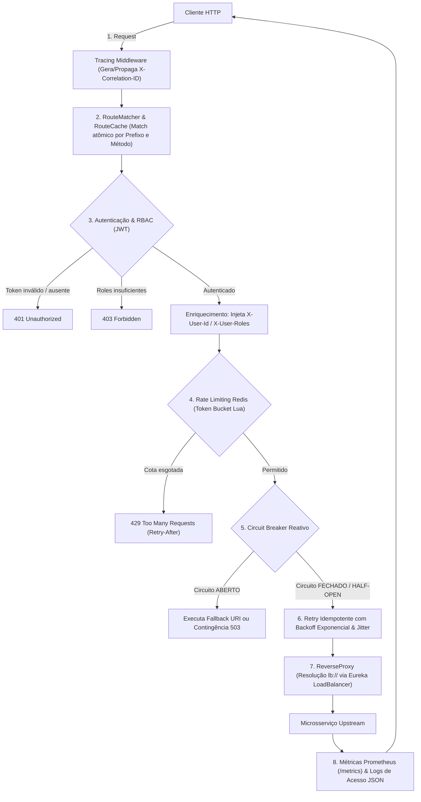

# 🚀 Scala 3 Production-Grade API Gateway

Um **API Gateway** de alto desempenho, resiliente e de nível de produção construído inteiramente em **Scala 3 (LTS 3.3.3)** utilizando o ecossistema puramente funcional Typelevel: **Cats Effect 3**, **FS2**, **Http4s (Ember)**, **Doobie**, **Flyway**, **Redis4Cats**, **Netflix Eureka** e **Prometheus**.

O projeto adota arquitetura funcional pura com streaming *zero-buffering*, sem geração de classes desnecessárias para repositórios ou serviços (utilizando o padrão funcional `trait Service[F[_]]` + companion `object Service.apply(...)`).

---

## 📑 Sumário

- [Visão Geral e Arquitetura do Pipeline](#-visão-geral-e-arquitetura-do-pipeline)
- [Funcionalidades Principais](#-funcionalidades-principais)
- [Tecnologias Utilizadas](#-tecnologias-utilizadas)
- [Estrutura do Projeto](#-estrutura-do-projeto)
- [Pré-requisitos](#-pré-requisitos)
- [Executando a Infraestrutura Local](#-executando-a-infraestrutura-local)
- [Execução da Aplicação e Testes](#-execução-da-aplicação-e-testes)
- [Guia da API Administrativa](#-guia-da-api-administrativa)
- [Fluxo de Autenticação e Autorização (JWT / RBAC)](#-fluxo-de-autenticação-e-autorização-jwt--rbac)
- [Rate Limiting Distribuído com Redis](#-rate-limiting-distribuído-com-redis)
- [Resiliência: Circuit Breaker, Retry e Fallback](#-resiliência-circuit-breaker-retry-e-fallback)
- [Observabilidade: Métricas Prometheus, Tracing e Logs JSON](#-observabilidade-métricas-prometheus-tracing-e-logs-json)
- [Variáveis de Ambiente](#-variáveis-de-ambiente)

---

## 🏛️ Visão Geral e Arquitetura do Pipeline

Cada requisição que chega ao Gateway passa por um pipeline modular, não bloqueante e com tratamento de contexto assíncrono:



---

## ✨ Funcionalidades Principais

* **Proxy Reverso Streaming com Zero-Buffering:** Encaminhamento direto de requisições e respostas usando `fs2.Stream` com baixo consumo de memória, limpeza de cabeçalhos *hop-by-hop* (RFC 7230) e injeção de `X-Forwarded-*`.
* **Persistência Relacional e Hot Reload:** Armazenamento das rotas no **PostgreSQL 16** via **Doobie** e **Flyway**. Cache em memória concorrente pré-aquecido via `Ref` com recarregamento a quente via endpoint de reload (`/admin/routes/reload`) sem *downtime*.
* **Service Discovery & Load Balancing (Netflix Eureka):**
  - Cliente nativo puramente HTTP REST com `http4s-ember-client` (livre do SDK legado Netflix/Jersey).
  - Auto-registro, batimentos periódicos (*heartbeats*) e sincronização periódica de instâncias ativas via fibras em segundo plano.
  - Resolução de URIs com esquema lógico `lb://NOME-DO-SERVICO` com algoritmo de balanceamento **Round-Robin** *lock-free*.
* **Segurança e RBAC (Role-Based Access Control):**
  - Validação stateless de tokens JWT (HMAC-SHA256) na borda da aplicação.
  - Sanitização de cabeçalhos externos `X-User-*` contra ataques de *header spoofing*.
  - Injeção segura de contexto autenticado (`X-User-Id` e `X-User-Roles`) para consumo pelos microsserviços internos.
* **Rate Limiting Distribuído (Redis):**
  - Algoritmo *Token Bucket* executado atomicamente via script Lua no Redis.
  - Limitação por ID do usuário autenticado ou por endereço IP para rotas públicas.
  - Retorno padrão de status `429 Too Many Requests` acompanhado dos headers `Retry-After`, `X-RateLimit-Limit` e `X-RateLimit-Remaining`.
  - Fallback concorrente `inMemory` automático em caso de indisponibilidade momentânea do Redis.
* **Resiliência Funcional Avançada:**
  - **Circuit Breaker:** Máquina de estados atômica (`Closed`, `Open`, `HalfOpen`) por rota, impedindo sobrecarga em serviços degradados e emitindo cabeçalho `X-Circuit-Breaker: OPEN`.
  - **Retry Policy:** Retentativas automáticas exclusivamente para métodos HTTP **idempotentes** (`GET`, `PUT`, `DELETE`, `HEAD`, `OPTIONS`) em falhas de rede ou status 502/503/504, aplicando backoff exponencial com jitter aleatório.
  - **Fallback:** Roteamento automático de contingência para endpoint alternativo (`fallbackUri`) quando o circuito estiver aberto ou o retry esgotar.
* **Observabilidade Completa:**
  - **Tracing Distribuído:** Geração e propagação transparente de `X-Correlation-ID` de ponta a ponta.
  - **Métricas para Prometheus:** Endpoint `/metrics` expondo contadores de requisições por rota/método/status, histograma de latência ponta a ponta e calibre do estado dos circuit breakers.
  - **Logs Estruturados em JSON:** Emissão de logs de acesso padronizados para indexação (Elasticsearch, Loki, CloudWatch).

---

## 🛠️ Tecnologias Utilizadas

| Componente | Tecnologia | Versão |
| :--- | :--- | :--- |
| **Linguagem** | Scala 3 (LTS) | `3.3.3` |
| **Plataforma JVM** | OpenJDK | `21` |
| **Build Tool** | SBT | `1.9.9` |
| **Efeito & Concorrência** | Cats Effect / FS2 | `3.x` |
| **Servidor & Cliente HTTP**| Http4s (Ember Server & Client) | `1.0.0-M29` |
| **JSON Serialization** | Circe | `0.14.3` |
| **Persistência / SQL** | Doobie (HikariCP + Postgres) | `1.0.0-RC5` |
| **Migrações de Banco** | Flyway | `9.22.3` |
| **Redis Reativo** | Redis4Cats (Lettuce) | `1.5.2` |
| **Validação JWT** | Java-JWT (Auth0) | `4.4.0` |
| **Métricas** | Prometheus Simpleclient | `0.16.0` |
| **Framework de Testes** | MUnit + MUnit Cats Effect 3 | `0.7.29` / `1.0.6` |

---

## 📂 Estrutura do Projeto

```text
api-gateway/
├── docker-compose.yml              # Orquestração do Postgres, Eureka, Redis e Prometheus
├── prometheus.yml                  # Configuração de raspagem de métricas do Prometheus
├── build.sbt                       # Dependências e configurações de compilação Scala 3
├── project/                        # Configurações do SBT
└── src/
    ├── main/
    │   ├── resources/
    │   │   ├── db/migration/
    │   │   │   ├── V1__create_routes_table.sql
    │   │   │   └── V2__add_security_and_resilience_to_routes.sql
    │   │   └── logback.xml
    │   └── scala/com/example/apigateway/
    │       ├── Main.scala          # Ponto de entrada IOApp
    │       ├── ApigatewayServer.scala # Orquestração do ciclo de vida dos recursos
    │       ├── admin/              # API Administrativa (/admin/routes)
    │       ├── auth/               # AuthService, AuthMiddleware e RBAC
    │       ├── cache/              # RouteCache concorrente em memória via Ref
    │       ├── config/             # AppConfig e carregamento via variáveis de ambiente
    │       ├── db/                 # Repositório Doobie e Migrador Flyway
    │       ├── discovery/          # EurekaClient, ServiceRegistry e LoadBalancer
    │       ├── model/              # Modelos de domínio (Route, RouteRecord)
    │       ├── observability/      # TracingMiddleware, MetricsService e AccessLog
    │       ├── proxy/              # ReverseProxy streaming e ProxyRoutes unificado
    │       ├── ratelimit/          # RateLimiter Token Bucket (Lua/Redis) e Middleware
    │       ├── resilience/         # CircuitBreaker e RetryPolicy
    │       └── routing/            # RouteMatcher com ordenação por especificidade
    └── test/scala/com/example/apigateway/
        ├── admin/                  # Testes da API de administração
        ├── auth/                   # Testes de geração/validação JWT e RBAC
        ├── cache/                  # Testes de cache atômico e hot-reload
        ├── db/                     # Testes de banco e migrations reais
        ├── discovery/              # Testes de decodificação Eureka e Load Balancer
        ├── e2e/                    # Bateria de testes de integração ponta a ponta
        ├── observability/          # Testes de Tracing e Métricas Prometheus
        ├── proxy/                  # Testes de proxy reverso e resolução lb://
        ├── ratelimit/              # Testes de Rate Limiting (in-memory e Redis real)
        └── resilience/             # Testes de máquina de estados do Circuit Breaker e Retry
```

---

## ⚙️ Pré-requisitos

* **Java Development Kit (JDK):** Versão 21 recomendada.
* **SBT:** Versão 1.9.x ou superior.
* **Docker & Docker Compose:** Para subir PostgreSQL, Eureka, Redis e Prometheus.

---

## 🐳 Executando a Infraestrutura Local

Suba todos os serviços de suporte necessários com o Docker Compose:

```bash
docker compose up -d
```

Serviços iniciados:
- **PostgreSQL 16:** porta `5432` (`localhost:5432/apigateway`)
- **Netflix Eureka Server:** porta `8761` (Painel Web: `http://localhost:8761`)
- **Redis 7 (Alpine):** porta `6379`
- **Prometheus Server:** porta `9090` (Painel Web: `http://localhost:9090`)

Para verificar se todos os containers estão saudáveis:
```bash
docker ps
```

---

## 🚀 Execução da Aplicação e Testes

### Executar a Aplicação

```bash
sbt run
```

Ao iniciar, a aplicação:
1. Aplica as migrações do banco com o **Flyway**.
2. Conecta ao **PostgreSQL** via HikariCP e carrega as rotas ativas no **RouteCache**.
3. Registra a si mesma no **Eureka** e inicia o *background sync* de catálogo.
4. Conecta ao **Redis** para Rate Limiting distribuído.
5. Inicia o servidor **Ember HTTP** na porta `8080`.

### Executar a Suíte Completa de Testes

O projeto conta com **52 testes automatizados** abrangendo testes unitários e de integração de ponta a ponta:

```bash
sbt test
```

---

## 📋 Guia da API Administrativa

A API administrativa permite gerenciar rotas dinamicamente no banco e atualizar o cache do Gateway em tempo de execução sem reiniciar o servidor. Todas as chamadas exigem o cabeçalho `X-Admin-Key` configurado.

### 1. Criar uma Nova Rota

```bash
curl -X POST http://localhost:8080/admin/routes \
  -H "X-Admin-Key: admin-secret-key" \
  -H "Content-Type: application/json" \
  -d '{
    "id": "servico-pedidos",
    "prefix": "/api/v1/pedidos",
    "methods": ["GET", "POST"],
    "targetUri": "lb://SERVICO-PEDIDOS",
    "stripPrefix": true,
    "enabled": true,
    "authRequired": true,
    "requiredRoles": ["admin", "gestor"],
    "rateLimitCapacity": 10,
    "rateLimitRefillRate": 2,
    "circuitBreakerEnabled": true,
    "fallbackUri": "http://localhost:8089/contingencia"
  }'
```

### 2. Listar Rotas Cadastradas

```bash
curl -X GET http://localhost:8080/admin/routes \
  -H "X-Admin-Key: admin-secret-key"
```

### 3. Consultar Rota por ID

```bash
curl -X GET http://localhost:8080/admin/routes/servico-pedidos \
  -H "X-Admin-Key: admin-secret-key"
```

### 4. Atualizar uma Rota Existente

```bash
curl -X PUT http://localhost:8080/admin/routes/servico-pedidos \
  -H "X-Admin-Key: admin-secret-key" \
  -H "Content-Type: application/json" \
  -d '{
    "prefix": "/api/v1/pedidos",
    "methods": ["GET", "POST", "PUT"],
    "targetUri": "lb://SERVICO-PEDIDOS",
    "stripPrefix": true,
    "enabled": true,
    "authRequired": true,
    "requiredRoles": ["admin"],
    "rateLimitCapacity": 20,
    "rateLimitRefillRate": 5,
    "circuitBreakerEnabled": true
  }'
```

### 5. Excluir uma Rota

```bash
curl -X DELETE http://localhost:8080/admin/routes/servico-pedidos \
  -H "X-Admin-Key: admin-secret-key"
```

### 6. Recarregar Cache em Tempo Real (Hot-Reload)

```bash
curl -X POST http://localhost:8080/admin/routes/reload \
  -H "X-Admin-Key: admin-secret-key"
```

---

## 🔒 Fluxo de Autenticação e Autorização (JWT / RBAC)

Para rotas onde `"authRequired": true`:

1. **Sem Token ou Token Inválido:**
   ```bash
   curl -i http://localhost:8080/api/v1/pedidos
   # HTTP/1.1 401 Unauthorized
   # {"error":"Unauthorized","message":"Cabeçalho Authorization com token Bearer ausente."}
   ```

2. **Com Token mas Permissões Insuficientes:**
   Se o token possuir apenas role `usuario`, mas a rota exigir `admin`:
   ```bash
   curl -i http://localhost:8080/api/v1/pedidos \
     -H "Authorization: Bearer <TOKEN_JWT_ROLE_USUARIO>"
   # HTTP/1.1 403 Forbidden
   # {"error":"Forbidden","message":"Acesso proibido. Roles necessárias: [admin], roles do usuário: [usuario]."}
   ```

3. **Com Token Válido e Roles Adequadas:**
   O Gateway autoriza a chamada, remove cabeçalhos externos inseguros e injeta novos cabeçalhos confiáveis para o microsserviço upstream:
   - `X-User-Id: <id-do-usuario>`
   - `X-User-Roles: admin,gestor`
   - `X-Correlation-ID: <uuid-do-trace>`

---

## ⏱️ Rate Limiting Distribuído com Redis

Ao configurar `rateLimitCapacity` e `rateLimitRefillRate` na rota:
* Cada requisição consome 1 token via script Lua atômico no Redis.
* Quando a cota de tokens é esgotada, o Gateway rejeita chamadas adicionais instantaneamente:

```bash
# Resposta ao esgotar tokens:
HTTP/1.1 429 Too Many Requests
Content-Type: application/json
X-RateLimit-Limit: 10
X-RateLimit-Remaining: 0
Retry-After: 3

{"error":"Too Many Requests","message":"Limite de requisições excedido. Tente novamente em 3 segundo(s)."}
```

---

## 🛡️ Resiliência: Circuit Breaker, Retry e Fallback

* **Circuit Breaker:** Se o serviço de destino responder com status `5xx` ou falhas consecutivas de rede atingirem o limiar configurado (`CB_FAILURE_THRESHOLD`), o disjuntor transiciona para **OPEN**.
  - Durante o estado OPEN, o Gateway devolve imediatamente resposta rápida sem sobrecarregar o microsserviço:
    ```http
    HTTP/1.1 503 Service Unavailable
    X-Circuit-Breaker: OPEN
    ```
* **Fallback Automático:** Se a rota possuir `fallbackUri` cadastrado, a chamada é despachada automaticamente para a URI de contingência ao invés de devolver 503.
* **Retry Inteligente:** Caso ocorram erros transitórios (`502 Bad Gateway`, `504 Gateway Timeout`), métodos idempotentes (`GET`, `PUT`, `DELETE`) são retentados com backoff exponencial e jitter. Métodos com efeitos colaterais (`POST`) nunca são retentados.

---

## 📊 Observabilidade: Métricas Prometheus, Tracing e Logs JSON

### 1. Métricas para Prometheus (`/metrics`)

O Gateway disponibiliza nativamente o endpoint `/metrics` para raspagem do Prometheus:

```bash
curl http://localhost:8080/metrics
```

Métricas exportadas:
* `gateway_requests_total{route="...", method="...", status="..."}`: Total de requisições processadas.
* `gateway_request_duration_seconds{route="...", method="..."}`: Histograma com latência em segundos dividida em percentis.
* `gateway_circuit_breaker_state{route="..."}`: Estado do disjuntor (0 = Closed, 1 = HalfOpen, 2 = Open).

### 2. Tracing Distribuído (`X-Correlation-ID`)

Se o cliente enviar o header `X-Correlation-ID`, ele é preservado. Caso contrário, um identificador único UUID v4 é gerado automaticamente, propagado para o upstream e devolvido no cabeçalho da resposta.

### 3. Logs Estruturados em JSON

Todos os acessos são logados em formato JSON estruturado no console:

```json
{
  "timestamp": "2026-09-30T19:30:00.123456Z",
  "correlationId": "b351ebfd-ea61-4ecd-9058-92feac83faf9",
  "clientIp": "192.168.1.100",
  "method": "GET",
  "path": "/api/v1/pedidos",
  "routeId": "servico-pedidos",
  "status": 200,
  "durationMs": 14,
  "upstream": "http://10.0.0.12:8081/pedidos"
}
```

---

## 🔧 Variáveis de Ambiente e Arquivo `.env`

O projeto suporta carregamento automático de variáveis a partir do arquivo `.env` na raiz do projeto (ou diretamente das variáveis de ambiente do sistema operacional / container).

Para configurar o ambiente de desenvolvimento local, copie o modelo:
```bash
cp .env.example .env
```

> [!IMPORTANT]
> As variáveis sensíveis **não possuem valores padrão hardcoded no código**. Caso não sejam definidas via `.env` ou variáveis do sistema operacional, a aplicação interrompe a inicialização com erro (`IllegalStateException`).

| Variável | Obrigatória / Padrão | Descrição |
| :--- | :--- | :--- |
| `DB_PASSWORD` | **Obrigatória** (via `.env`) | Senha do PostgreSQL |
| `ADMIN_API_KEY` | **Obrigatória** (via `.env`) | Chave de segurança para a API `/admin` (`X-Admin-Key`) |
| `JWT_SECRET` | **Obrigatória** (via `.env`) | Segredo compartilhado HMAC-SHA256 para tokens JWT |
| `PORT` / `INSTANCE_PORT` | `8080` | Porta HTTP onde o Gateway escuta requisições |
| `DB_HOST` | `localhost` | Host do banco PostgreSQL |
| `DB_PORT` | `5432` | Porta do PostgreSQL |
| `DB_NAME` | `apigateway` | Nome do banco de dados |
| `DB_USER` | `postgres` | Usuário do banco |
| `DB_POOL_SIZE` | `10` | Tamanho do pool de conexões HikariCP |
| `EUREKA_URL` | `http://localhost:8761/eureka` | URL base do Eureka Server |
| `EUREKA_APP_NAME` | `API-GATEWAY` | Nome do Gateway no registro Eureka |
| `INSTANCE_HOST` | `localhost` | Host do Gateway informado ao Eureka |
| `EUREKA_REGISTER` | `true` | Habilita auto-registro no Eureka |
| `EUREKA_REFRESH_INTERVAL`| `10` | Intervalo em segundos de sincronização do catálogo |
| `EUREKA_HEARTBEAT_INTERVAL`| `30` | Intervalo em segundos do batimento do Eureka |
| `EUREKA_ENABLED` | `true` | Habilita o cliente Eureka |
| `JWT_ISSUER` | `apigateway` | Emissor esperado no token JWT (`iss`) |
| `REDIS_HOST` | `localhost` | Host do servidor Redis |
| `REDIS_PORT` | `6379` | Porta do Redis |
| `REDIS_ENABLED` | `true` | Habilita o limitador distribuído via Redis |
| `CB_FAILURE_THRESHOLD` | `5` | Número de falhas consecutivas para abrir o disjuntor |
| `CB_OPEN_DURATION_MS` | `10000` | Tempo (ms) que o disjuntor permanece aberto antes do HalfOpen |
| `RETRY_MAX_ATTEMPTS` | `3` | Tentativas máximas de retry em métodos idempotentes |
| `RETRY_INITIAL_DELAY_MS` | `100` | Delay inicial em milissegundos para o backoff exponencial |
